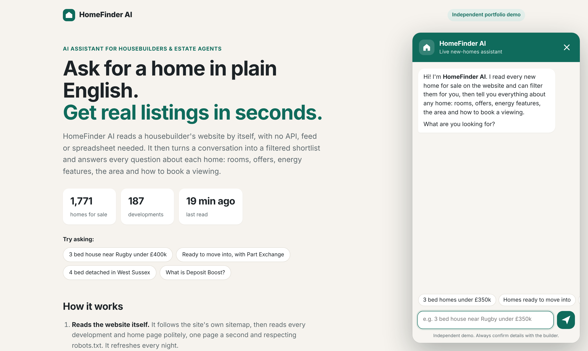
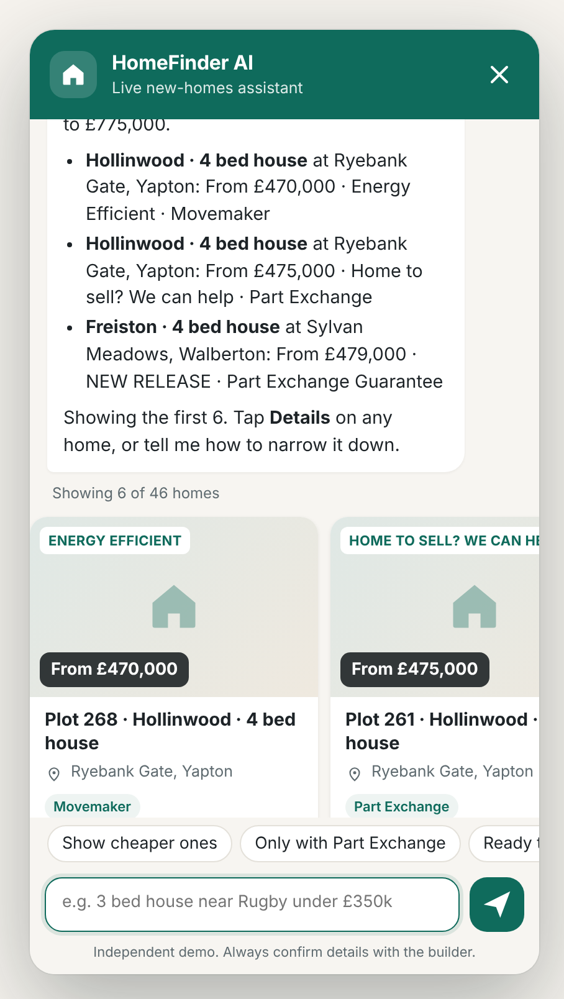
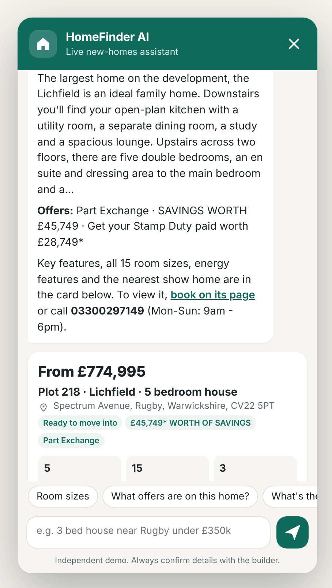
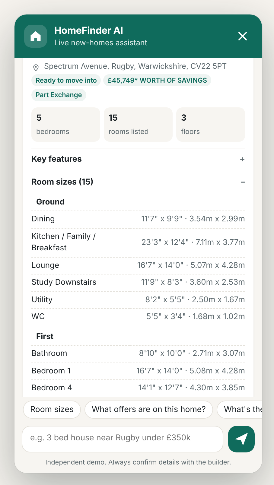
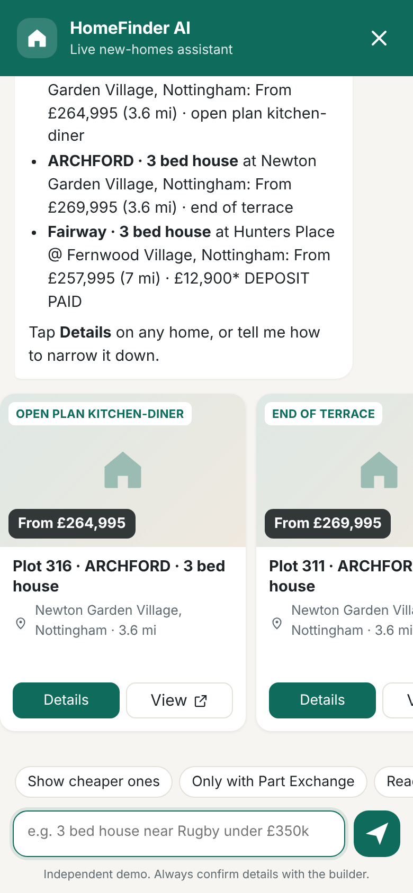

# HomeFinder AI

**An AI chat assistant that reads a housebuilder's website by itself, turns a conversation into a filtered shortlist of homes, and answers every question about each property.**

No API, data feed or spreadsheet is needed. HomeFinder AI follows the website's own sitemap, reads every development and home page, and keeps itself up to date.



| Search in plain English | Everything about a home | Room-by-room sizes |
|---|---|---|
|  |  |  |

<p align="center"></p>

*Screenshots use live data read from the website (1,771 homes across 187 developments). The site's photos are replaced with a placeholder here because they weren't loadable in the screenshot environment. In normal use the real photos show.*

> **Independent portfolio demo.** It runs against the public [David Wilson Homes](https://www.dwh.co.uk) website and is not affiliated with or endorsed by David Wilson Homes or Barratt Redrow plc. Every home links back to its official page, and prices, offers and availability should always be confirmed with the builder.

## What a customer can do

- **Search in plain English.** For example: *"3 bed house near Rugby under £350k"*, *"4 bed detached in West Sussex with Part Exchange"*, *"something ready to move into within 15 miles of Leeds"*.
- **Refine as they go.** *"only ones with a garage"*, *"show me cheaper ones"*, *"what about 4 beds?"*
- **Ask anything about a home:**
  - room-by-room dimensions from the floor plans;
  - offers (Part Exchange, Deposit Boost, Stamp Duty paid, Key Worker…);
  - energy features and the nearest show home;
  - local schools, transport and shops;
  - how to book a viewing.
- **Ask general questions,** such as *"What is Part Exchange?"*, *"How does stamp duty work on a new build?"*, *"Leasehold or freehold?"* These are answered from the site's own buying guides.

## How it works

```
                 sitemap.xml
                      │
      ┌───────────────┼────────────────────┐
      ▼               ▼                    ▼
 187 development   1,771 home pages    200 buying-guide /
 pages             (rooms, features,   offers / FAQ pages
 (location, offers, energy, images)
  homes for sale)
      │               │                    │
      └──── polite crawler: robots.txt, 1 request/second, retries, nightly refresh
                      │
                      ▼
          Site index (JSON) + postcode lookup (county, region, map position)
                      │
 Customer ──► Chat widget ──► /api/chat ──► Claude (tool use) ──┬─ search_homes      filters + distance
                                                                ├─ get_home_details  re-reads the live page
                                                                ├─ get_development   area, hours, homes
                                                                ├─ search_site_info  buying guides
                                                                └─ list_areas
                      ◄── reply + home cards + suggested follow-ups
```

- **Reads the website itself.** It starts from `sitemap.xml`, reads each development page (with its list of homes for sale), each home's page and the information pages. It parses:
  - the HTML;
  - schema.org JSON-LD;
  - the site's own meta tags;
  - the floor-plan data inside the page.
- **Keeps answers current.** Before talking about a home it re-reads that home's page (cached for 24 hours), so the price and availability are live. The whole index refreshes in the background every night.
- **Claude decides which tools to use.** Claude reads the conversation, picks filters and looks up details through five read-only tools, and only states what those tools return. Website text is treated as data, never as instructions.
- **Works with no API key.** A built-in rule-based assistant understands the same kinds of requests (bedrooms, budget, place, distance, style, offers, features, "the second one", "room sizes"), so the demo works offline and costs nothing.
- **Honest by design.** When something can't be checked yet (for example a house style it hasn't read), the assistant says so instead of guessing.

## Tech stack

| Layer | Tools |
|---|---|
| Server | Node.js 20+, Express, zod validation, helmet (strict CSP), rate limiting |
| Crawling | native `fetch`, cheerio, sitemap + robots.txt parsers, p-limit, polite rate limiting with retry/backoff |
| Search | Filters, distance (haversine), free UK postcode and place lookup via [postcodes.io](https://postcodes.io), keyword ranking over guide pages |
| AI | Anthropic Claude (`claude-haiku-5-5` by default) with tool use; rule-based fallback |
| Widget | Dependency-free JavaScript in a Shadow DOM, embeddable with one `<script>` tag, mobile full-screen |
| Quality | Vitest + supertest (53 tests on fictional fixture pages), GitHub Actions, Docker |

## Quick start

```bash
git clone https://github.com/ahmad0187/homefinder-ai.git
cd homefinder-ai
npm install
cp .env.example .env            # optional: add ANTHROPIC_API_KEY for Claude answers
npm run crawl -- --content      # reads developments, homes and guide pages (~10 min)
npm start                       # http://localhost:3000
```

For full details of every home (room sizes, features and energy for all homes, about 40 minutes):

```bash
npm run crawl -- --details
```

Without that step, details are read live the first time someone asks about a home.

To test quickly on just the first 5 developments: `npm run crawl -- --limit 5`.

## Add it to any website

```html
<script src="https://your-server.example/widget.js" defer></script>
```

You can customise it with data attributes:

```html
<script src="https://your-server.example/widget.js"
        data-title="Find your new home"
        data-accent="#0f6b5c"
        data-open="true" defer></script>
```

You can also control it from JavaScript, for example `window.HomeFinder.ask("3 bed homes in York")`, `HomeFinder.open()` or `HomeFinder.reset()`.

Set `ALLOWED_ORIGINS` to the websites allowed to call the API.

## Configuration

| Variable | Default | What it does |
|---|---|---|
| `ANTHROPIC_API_KEY` | – | Turns on Claude. Without it, the built-in assistant is used |
| `CLAUDE_MODEL` | `claude-haiku-5-5` | Model for answers |
| `SITE_URL` / `SITE_NAME` | dwh.co.uk / David Wilson Homes | The website to read |
| `ASSISTANT_NAME` | HomeFinder AI | Name shown in replies |
| `ALLOWED_ORIGINS` | `*` | Comma-separated sites that may embed the widget |
| `CRAWL_DELAY_MS` / `CRAWL_CONCURRENCY` | 1000 / 2 | Crawl politeness |
| `REFRESH_HOURS` | 24 | Rebuild the index in the background when older than this |
| `DETAIL_TTL_HOURS` | 24 | How long a home's live details are cached |
| `GEOCODE` | on | Free UK postcode and place lookup for "within 10 miles of…" |
| `SHOW_IMAGES` | on | Show the site's photos on cards |

## API

| Method | Endpoint | Description |
|---|---|---|
| `POST` | `/api/chat` | `{ message, history?, context?: { shownHomes, filters, focusHomeId }, action?: { type: "details", homeId } }` → `{ reply, homes, home, total, filters, suggestions, mode }` |
| `GET` | `/api/homes/:id` | One home in full (read live) |
| `GET` | `/api/health` | Index size, last crawl time, AI mode |

## Project structure

```
src/
  crawl/        fetcher.js (robots.txt, rate limit, retries), crawler.js (sitemap → pages → index; live details), robots.js
  parse/        development.js, plot.js, content.js, sitemap.js, util.js – page readers
  index/        store.js (the site index on disk), search.js (filters, distance, offers, guide search)
  geo/          geocode.js – postcodes.io lookups and distances
  agent/        claude.js (tool-use loop), tools.js (5 tools), fallback.js (rule-based assistant), index.js
  app.js        Express API + static widget
  server.js     Startup and nightly refresh
  cli/crawl.js  npm run crawl
public/         widget.js (embeddable chat), index.html (demo page)
test/           Unit and API tests with fictional fixture pages
```

## Using it for another website

The page readers in `src/parse/` are the only site-specific part. For another builder or estate agent you would:

1. point `SITE_URL` at their site;
2. adjust the CSS selectors in `development.js` and `plot.js` to their page layout;
3. if their sitemap names differ, change the patterns in `crawler.js`.

Everything else (search, AI tools, widget, API) stays the same.

## Responsible crawling

- Obeys `robots.txt` and only fetches pages on the configured site.
- Identifies itself with a clear user agent that links to this repo.
- Makes about one request per second, backs off on errors, and does a full refresh at most once a day.
- Stores no personal data. Viewings and enquiries go through the builder's own pages.
- For a real deployment, get the website owner's permission. Images are shown from the builder's site and link back to it.

## License

MIT. Built by [Ahmad Murtaza](https://github.com/ahmad0187).
